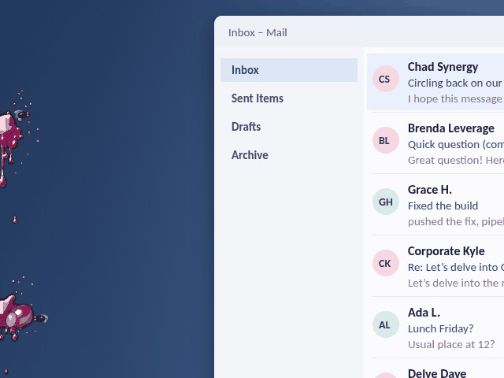
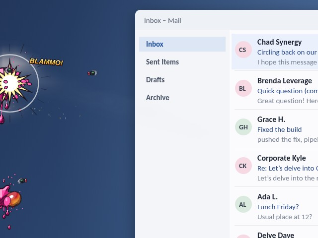
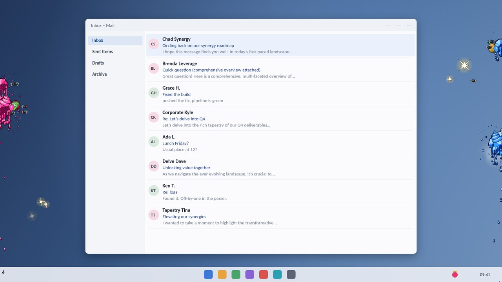
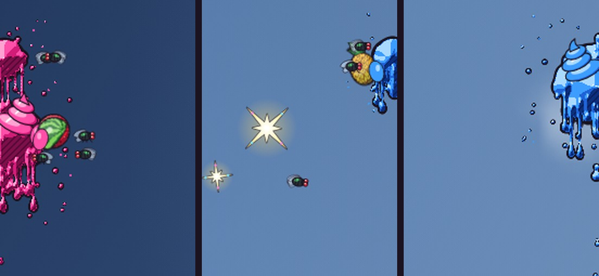
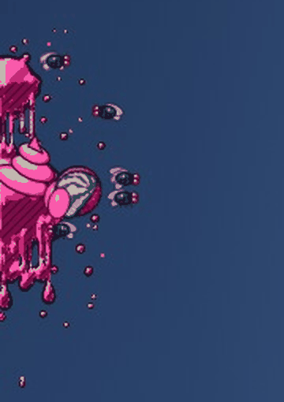
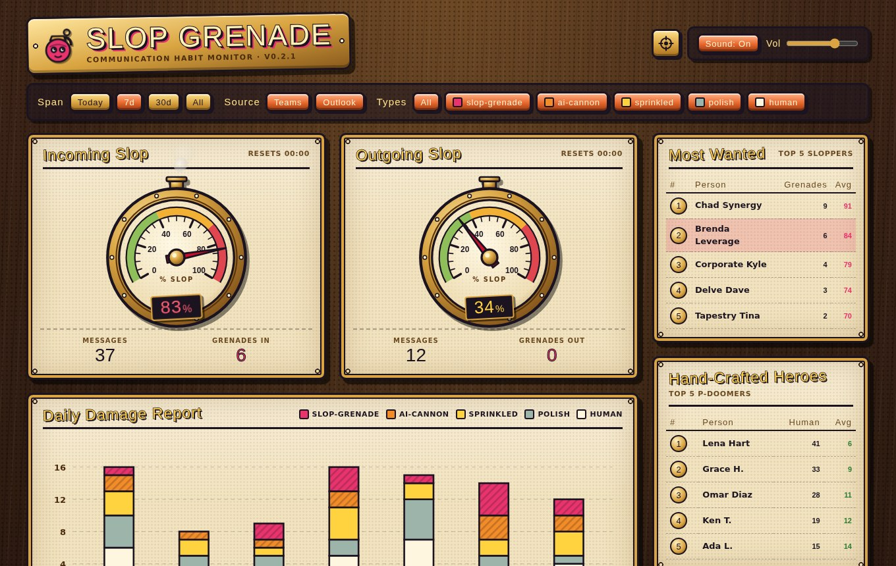
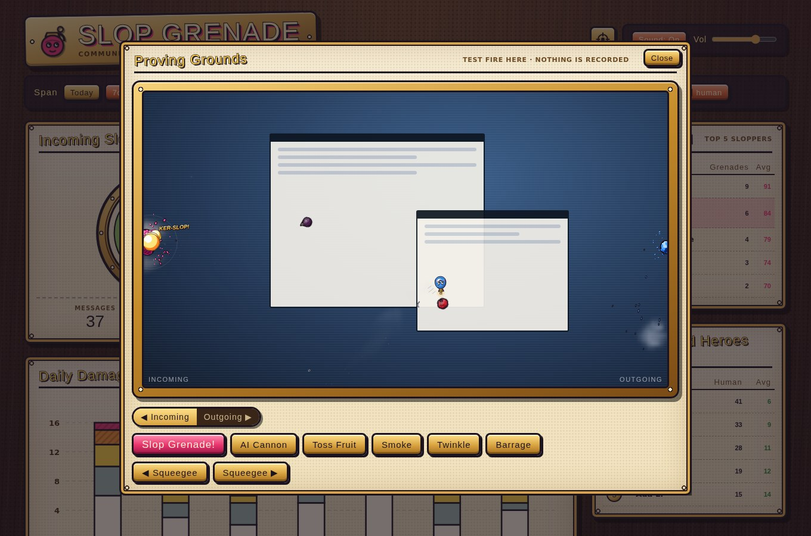

# Slop Grenade

**Slop Grenade** is a lightweight Windows desktop companion that helps you and your team notice—and break—the habit of sending unedited AI-generated fluff in Microsoft Teams and Outlook.

It runs quietly in the background on your Windows PC, watches the messages you send and receive across Microsoft 365, and gives instant visual feedback right on the edges of your monitor.

<p align="center">
  
</p>

<p align="center"><b>Someone just sent you slop. Now it is on your screen.</b></p>

---

## The Philosophy: Why "Slop Grenade"?

We have all been on the receiving end of a **Slop Grenade**:
- Someone types a five-second prompt into an AI assistant (*"Write a comprehensive update on Q4 priorities"*).
- Without editing, trimming, or adding any real human thought, they paste 500 words of bolded bullet points (`- **Strategic Alignment:** Fostering holistic synergy...`) into a Teams chat or email thread and hit **Send**.
- It took the sender **10 seconds** to pull the pin and throw. It now takes everyone else on the team **20 minutes** to wade through the sludge and figure out what the sender actually wants.

Good workplace communication is short, human, and considerate of other people's attention. **Slop Grenade** exists to make invisible cognitive pollution visible—especially in **your own outgoing messages**—so you can build better communication habits day by day.

---

## What Happens on Your Screen

Slop Grenade overlays your main Windows desktop monitor without interrupting your work (you can click and type right through the effects in any app). Everything is drawn small and kept to the edges of the screen, in a comic, cel-shaded style with ink outlines:

- **`human` (0-19)**: A short, bright crystal twinkle near the edge.
- **`polish` (20-39)**: A small puff of smoke rolls in from the edge of your monitor. It swirls when anything flies through it and fades away within about 15 seconds.
- **`sprinkled` (40-59)**: One of **20 cel-shaded 3D fruits** is tossed across the screen, tumbling on a random axis. It sticks only if it hits slop on the edge; otherwise it sails off the screen.
- **`ai-cannon` (60-79)**: A goo cannonball splats onto the edge of your screen and stays until squeegeed.
- **`slop-grenade` (80-100)**: A small, cheeky grenade pulls its own pin and is thrown at the edge of your monitor. Time slows for a moment just before it hits, then it pops with a small blast and comic sound word and splatters slop on the edge:
  - **Slop You Receive (Left Side of Monitor)**: Builds up in **Pink**.
  - **Slop You Send (Right Side of Monitor)**: Builds up in **Blue**.
  - **Ooze**: Slop keeps oozing slowly down the edge: drips stretch, a drop lets go and falls, and the drip starts again.
  - **Flies**: Leave slop on the screen for a while (45 seconds by default) and flies start to gather and buzz around it.
  - **Daily Buildup & Squeegee**: Fruit and slop stay stuck along the sides of your monitor until you squeegee that side clean from the tray icon. The squeegee also chases the flies away.
- **Sound (optional)**: Switch on **Sound FX** in the tray panel for soft, retro sounds in the style of early Macintosh games: a light whee, a ticking fuse, plops, a quiet hum from the flies and a rounded "pomf" for the grenade. Sound is off by default.

---

## See It in Action

### Incoming!

<p align="center">
  
</p>

A message scores 80 or more, a grenade pulls its own pin, and time slows for a heartbeat before it pops on the edge of your monitor. Received slop lands on the left in pink. Slop you send lands on the right in blue.

### After a busy morning

<p align="center">
  
</p>

Everything stays at the edges, out of the way of your work, and you can click straight through it.

<p align="center">
  
</p>

Up close: fruit only sticks where it hits goo, flies show up when slop is left on the screen too long, and genuinely human messages get a crystal twinkle.

<p align="center">
  
</p>

The slop never quite settles. Drips stretch, a drop lets go, and the drip starts again until you grab the squeegee.

### The dashboard

<p align="center">
  
</p>

Daily slop pressure gauges for what you receive and what you send, a Most Wanted list, and the Hand-Crafted Heroes who still write their own messages.

<p align="center">
  
</p>

The target icon opens a test range where you can fire every effect without touching your stats. Good for demos, and for showing the team what happens if they keep pasting unedited AI replies.

> Made someone laugh, or wince? Share the GIF at the top with your team.

---

## Step-by-Step Setup Guide

### Step 1: Sign In to Microsoft 365 (WorkIQ MCP)

Slop Grenade reads your Microsoft Teams and Outlook activity through the **WorkIQ** command-line tool using your normal Microsoft 365 sign-in.

Open PowerShell and run:

```powershell
# Accept the WorkIQ license agreement (first time only)
workiq accept-eula

# Sign in with your Microsoft 365 work account
workiq auth login
```

A standard Microsoft sign-in prompt will appear. Once signed in, WorkIQ can securely read your recent Teams and Outlook messages on your machine.

---

### Step 2: Sign In to GitHub Copilot (for LLM Slop Scoring)

To let Slop Grenade use **GitHub Copilot's LLM** alongside its built-in text analyzer, sign in with the GitHub CLI:

```powershell
gh auth login
```

Follow the on-screen prompt to sign in with your GitHub account that has GitHub Copilot access. Slop Grenade will automatically use your active GitHub session—no API keys or config files required.

---

### Step 3: Install and Run on Windows

From the repository folder, run the one-step local installer:

```powershell
.\scripts\install-local.ps1
```

What this does automatically:
1. Installs the app into your local Windows profile (`%LOCALAPPDATA%\SlopGrenade`).
2. Adds **Slop Grenade** shortcuts to your **Desktop** and **Start Menu**.
3. Configures Slop Grenade to **start automatically when you sign in to Windows** (you can toggle this on or off anytime from the System Tray icon).
4. Starts the background scanner and the desktop screen overlay immediately.

---

## Using the System Tray & Habit Dashboard

### 1. The System Tray Icon (Bright Pink Hand Grenade)
Look for the **Bright Pink Hand Grenade** icon in your Windows System Tray (bottom-right taskbar near the clock):
- Slop Grenade pings your **WorkIQ MCP** server every **1 minute** and triggers a desktop animation for each and every new message that comes through (automated and machine-generated system replies are always classified as the gentle `human` sparkle type).
- **Left-click the Tray Icon** to open the brass control panel where you can:
  - Read today's **Incoming** and **Outgoing** slop pressure gauges (they reset automatically at `00:00`).
  - Click **Squeegee** (left or right) to wipe your monitor edges clean.
  - Toggle **Launch at Windows sign-in**, **Teams / Outlook monitoring**, **Slop FX** and **Calm FX**.
  - Switch **Sound FX** on or off and pick a volume (**Soft**, **Med**, **Loud**).
  - Click **Test Fire!** to see every effect, or **Dashboard** to open the habit dashboard.
- **Right-click the Tray Icon** for quick test shots (a grenade at either edge, some fruit) and the squeegees.

### 2. The Habit Dashboard (`http://127.0.0.1:8090/`)
Clicking **Dashboard** in the tray opens the habit tracker in your browser, styled to match (brass, ink and parchment), featuring:
- **Incoming / Outgoing Slop Pressure Gauges** (0-100%) that vent steam when you are in the red.
- **Effects test range**: click the target icon in the header to open a small monitor where you can test fire every effect (test shots are not recorded in your stats). The **Sound** switch and volume slider sit next to it.
- **Per-Day Stacked Bar Chart** broken down by type (`slop-grenade` in pink, `ai-cannon` in orange, `sprinkled` in yellow, `polish` in smoke grey, and `human` in cream).
- **Filters** for time span (`Today`, `7d`, `30d`, `All`), source (`Teams` vs. `Outlook`), and message type (`All`, `slop-grenade`, `ai-cannon`, `sprinkled`, `polish`, `human`).
- **Top 5 Sloppers** and **Top 5 P-Doomers** (the colleagues who refuse to touch AI).
- **Interactive Drill-Down Grid** at the bottom ranked by highest slop score, showing the score, type, source, core metrics, sender, recipient, subject, and a short preview of each message.

---

## Technical Documentation

For architecture details, API endpoints, build/test commands, and container deployment templates, see [TECHNICAL.md](./TECHNICAL.md).
