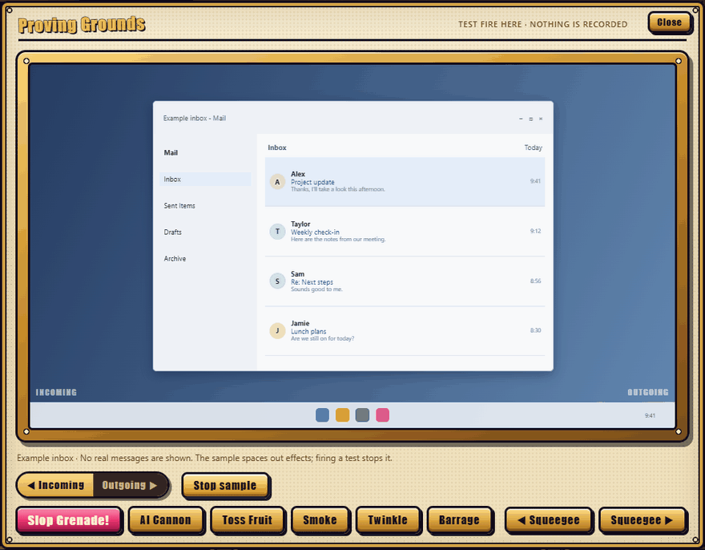

<p align="center">
  
</p>

# Slop Grenade

**Think before you slop.**

Slop Grenade helps you notice AI-like writing patterns in your connected email and chat. A playful desktop overlay and personal habit dashboard bring incoming messages and your own writing habits into view.

- **Spot incoming slop.** Screen-edge effects turn writing-style scores into grenades, goo, fruit, clouds, and sparkles.
- **Keep yourself honest.** Compare incoming and outgoing activity to reflect on your own use of AI.
- **Stay in control.** Filter your dashboard, adjust sound and effects, or try the test range without changing your statistics.

Scores are writing-style estimates, not proof that a message was generated by AI.

<p align="center">
  
</p>

---

## Dashboard

<p align="center">
  
</p>

### Using the dashboard (`A` – `M`)

- **A — Refresh Button**: Syncs the dashboard with the local detector and backfills recent messages for the selected time span without replaying old screen animations.
- **B — Effects Test Range (Target Icon)**: Opens an interactive preview monitor where you can test-fire grenades, cannons, fruit, smoke, sparkles, and squeegees without affecting your live statistics.
- **C — Sound FX & Volume Controls**: Toggles synthesized retro audio cues on or off and adjusts effect volume (`0%`–`100%`).
- **D — Time Span Filter (`Span`)**: Switches the active reporting window between **Today** (since local midnight), **Last 3 days** (rolling 72 hours), and **Last 7 days** (rolling 168 hours).
- **E — Direction Filter (`Direction`)**: Filters gauges, charts, leaderboards, and the ledger by **All**, **Incoming** (messages received), or **Outgoing** (messages sent by you).
- **F — Platform Source Filter (`Source`)**: Filters activity across connected communication platforms (**All**, **Chat**, or **Email**).
- **G — Detection Tier Filter (`Types`)**: Isolates messages by AI detection tier (**All**, **slop-grenade**, **ai-cannon**, **sprinkled**, **polish**, or **human**).
- **H — Incoming Slop Gauge**: Analog dial showing the percentage of incoming human-sent messages that read as AI-generated, along with total message, AI-written, and grenade counts.
- **I — Outgoing Slop Gauge**: Analog dial tracking the AI percentage of your own sent messages so you can catch yourself before getting lazy with AI.
- **J — Daily Damage Report**: Stacked timeline bar chart breaking down message volume by detection tier across time buckets (click any bar to filter the dashboard to that slice).
- **K — Most Wanted (`Highest % AI`)**: Top 5 contacts with the highest estimated share of AI-written messages in the selected window (click any person to filter the ledger).
- **L — Hand-Crafted Heroes (`Lowest % AI`)**: Top 5 contacts with the lowest estimated AI share.
- **M — The Ledger**: Sortable message history showing writing-style scores, dates, sources, sender and recipient details, and sanitized previews.

---

## Download and install

Get the latest desktop release from [**GitHub Releases**](https://github.com/threadkeeper/slop-grenade/releases/latest). Each download includes a separate SHA-256 checksum file so you can verify it before installing.

| Platform | Release Package | SHA-256 Checksum File |
| :--- | :--- | :--- |
| **Windows 10/11 (x64)** | [`slop-grenade-windows-x64.zip`](https://github.com/threadkeeper/slop-grenade/releases/latest/download/slop-grenade-windows-x64.zip) | [`slop-grenade-windows-x64.zip.sha256`](https://github.com/threadkeeper/slop-grenade/releases/latest/download/slop-grenade-windows-x64.zip.sha256) |
| **macOS 13+ (Universal)** | [`slop-grenade-macos-universal.tar.gz`](https://github.com/threadkeeper/slop-grenade/releases/latest/download/slop-grenade-macos-universal.tar.gz) | [`slop-grenade-macos-universal.tar.gz.sha256`](https://github.com/threadkeeper/slop-grenade/releases/latest/download/slop-grenade-macos-universal.tar.gz.sha256) |

### Verify your download and install

**Windows:**
```powershell
Invoke-WebRequest https://github.com/threadkeeper/slop-grenade/releases/latest/download/slop-grenade-windows-x64.zip -OutFile slop-grenade-windows-x64.zip
Invoke-WebRequest https://github.com/threadkeeper/slop-grenade/releases/latest/download/slop-grenade-windows-x64.zip.sha256 -OutFile slop-grenade-windows-x64.zip.sha256
$expected = (Get-Content .\slop-grenade-windows-x64.zip.sha256).Split(' ')[0].Trim().ToLowerInvariant()
$actual   = (Get-FileHash .\slop-grenade-windows-x64.zip -Algorithm SHA256).Hash.ToLowerInvariant()
if ($actual -eq $expected) { Write-Host "SHA-256 verified: $actual" -ForegroundColor Green } else { throw "SHA-256 mismatch!" }

Expand-Archive .\slop-grenade-windows-x64.zip -DestinationPath .\slop-grenade
.\slop-grenade\install-local.ps1
```

**macOS:**
```bash
curl -fsSLO https://github.com/threadkeeper/slop-grenade/releases/latest/download/slop-grenade-macos-universal.tar.gz
curl -fsSLO https://github.com/threadkeeper/slop-grenade/releases/latest/download/slop-grenade-macos-universal.tar.gz.sha256
shasum -a 256 -c slop-grenade-macos-universal.tar.gz.sha256

mkdir -p slop-grenade-macos && tar -xzf slop-grenade-macos-universal.tar.gz -C slop-grenade-macos
./slop-grenade-macos/install-macos.sh
```

**Android:** Currently available as test builds rather than a public release. See the [Android testing guide](./TECHNICAL.md#5-android-gmail-port) for build and setup instructions.

---

## Privacy and control

Slop Grenade is a **read-only, local-first** application:

- **Your messages are not changed.** Slop Grenade does not send, edit, or delete emails or chat messages.
- **Scoring stays local by default.** Raw message content is processed on your device and discarded after scoring. Your dashboard holds sanitized summaries in local memory. Optional AI-assisted evaluation must be explicitly enabled and uses only redacted snippets.
- **You control account access.** Signing out clears communication-derived history and active effects. Other connected accounts remain authorized and may repopulate history on later scans.
- **Desktop Gmail sessions are temporary.** Credentials are kept in memory, so restarting the background service requires reconnecting Gmail.

Slop Grenade's use and transfer to any other app of information received from Google APIs will adhere to the [Google API Services User Data Policy](https://developers.google.com/terms/api-services-user-data-policy), including the Limited Use requirements.

Read the [Privacy Policy](./PRIVACY.md), [Terms of Service](./TERMS.md), and [Security Overview](./SECURITY.md) for details.

---

## Documentation

- [How detection and scoring work](./research/ai-slop-and-slop-grenade.md)
- [Technical and developer guide](./TECHNICAL.md)
