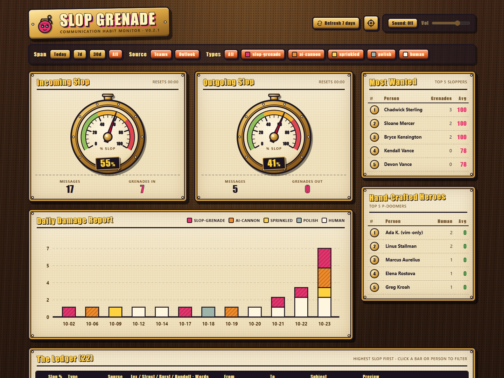
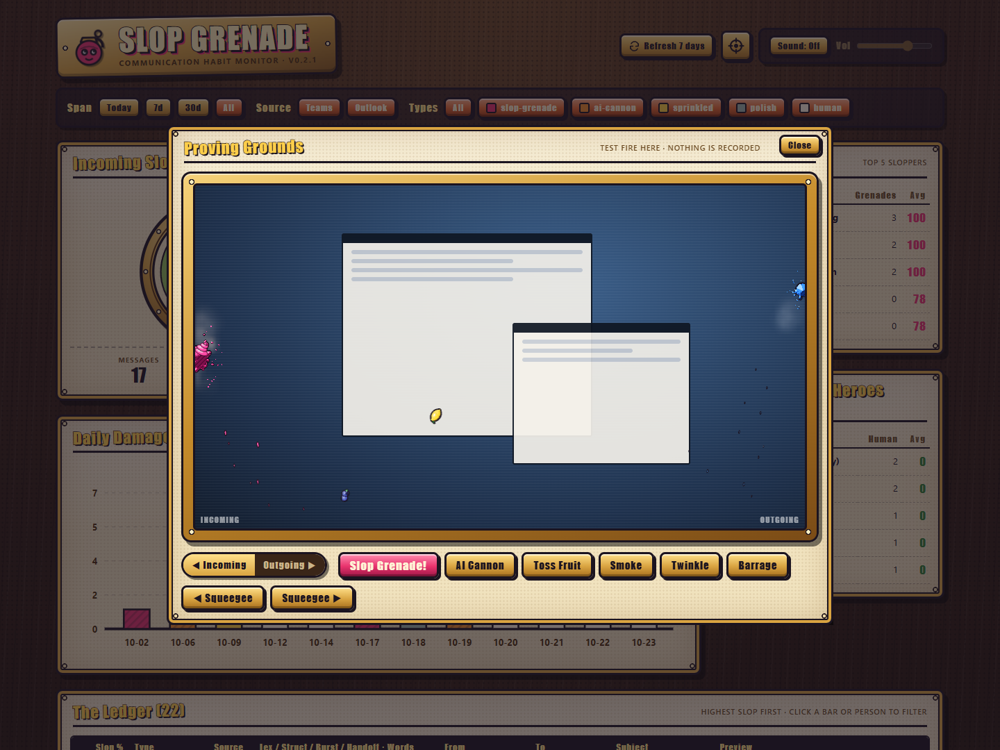
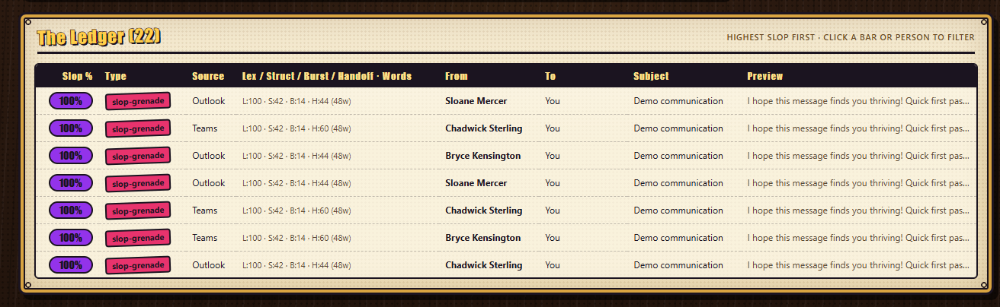

# Slop Grenade 💣

### Your desktop has opinions about corporate word soup.

Someone pastes a wall of *"holistic, cross-functional synergy"* into chat.
A tiny grenade lands on the edge of your screen. **Splat.**

**Slop Grenade is a Windows desktop companion that turns communication habits into comic-book effects.** Incoming fluff lands in pink. Your own outgoing fluff lands in blue. Clean, human messages get a little sparkle instead.

It is a mirror for your writing habits, not a courtroom for your colleagues.

[](#get-started)
[](./TECHNICAL.md)
[](./LICENSE)
[](https://github.com/threadkeeper/slop-grenade/stargazers)

**[Get started](#get-started)** · **[See the effects](#a-spectrum-of-splat)** · **[Connectors](#your-conversations-not-one-platform)** · **[Privacy](#your-messages-are-not-marketing-material)**



> **Fictional demo data only.** Every name, message, subject, and score in these screenshots is synthetic. No real account data was used or blurred into the images.

## The ten-second pitch

- **A tiny, click-through desktop overlay.** Keep typing, clicking, and working. The drama stays at the edges.
- **Pink in, blue out.** Notice the fluff you receive *and* the fluff you send.
- **A brass-and-parchment habit dashboard.** Pressure gauges, daily charts, filters, leaderboards, and message-level clues.
- **Refresh the last seven days in one click.** Merge history without duplicate counts or replaying a week's worth of explosions.
- **A squeegee for your desktop.** Clean the edges from the tray when enough is enough.
- **Optional retro sound effects.** Off by default. Your meeting does not need a surprise *pomf*.

## A spectrum of splat

| Communication vibe | Score | Desktop consequence |
| --- | --- | --- |
| **Human** | 0–19 | A brief crystal twinkle. Nice. |
| **Polish** | 20–39 | A small, drifting puff of smoke. |
| **Sprinkled** | 40–59 | One of 20 tumbling, cel-shaded fruits. Because apparently your email is a pear now. |
| **AI cannon** | 60–79 | A goo cannonball splats against the edge. |
| **Slop grenade** | 80–100 | A tiny grenade, a slow-motion moment, and a comic-book pop. |

Goop oozes. Fruit can stick to it. Leave the mess long enough and flies turn up.
The tray's **Squeegee** buttons restore a little dignity.



**Try the effects without changing your stats:** open the target icon in the dashboard header, then hit **Slop Grenade!**, **Toss Fruit**, or **Barrage**.

## Your conversations, not one platform

Slop is not exclusive to one inbox. The goal is a consistent little habit mirror across the places you communicate.

| Connector | Status |
| --- | --- |
| **Outlook + Teams** | Available today through the local WorkIQ CLI/MCP connection. |
| **Google Workspace / Gmail** | Experimental Android port; see [Android setup and limitations](./TECHNICAL.md#5-android-gmail-port). Google authorization setup and device acceptance are required. |
| **Slack** | Planned. Not implemented yet. |
| **More chat and email platforms** | On the roadmap. Ideas and contributions welcome. |

The current native overlay runs on **Windows**. The connector roadmap is not a claim that those integrations already work.

### Android Gmail port

The experimental, isolated `mobile/` application reuses the Rust scoring engine and Svelte dashboard for Gmail accounts, including received and already-sent mail. It does not monitor drafts or change scoring rules. Windows installation and WorkIQ remain unchanged.

Android scheduling is battery-managed, not continuous one-minute monitoring. Gmail access requires Google Play services, a configured Google OAuth client and read-only consent for each account; installing an APK does not bypass those requirements. See the [technical guide](./TECHNICAL.md#5-android-gmail-port) before building or installing.

## Get started

### 1. Bring the tools

You will need **Windows 10/11**, **Git**, **Rust stable**, a current **Node.js LTS** release, and **PowerShell**.
The installer also uses the Windows .NET Framework C# compiler.

For the currently available connectors, install the [official WorkIQ CLI](https://github.com/microsoft/work-iq) and use your work account with Outlook and Teams access.
You do **not** need to register a custom Entra application for Slop Grenade.
Your organization's normal account, licensing, and access policies still apply.

### 2. Clone, connect, launch

```powershell
git clone https://github.com/threadkeeper/slop-grenade.git
Set-Location .\slop-grenade
npm --prefix web install

# First-time WorkIQ setup: review and accept its license.
workiq accept-eula

# Reuse your cached work login, or complete the normal sign-in prompt.
workiq ask --question "Reply only with OK."

# Build, install, create shortcuts, and open the dashboard.
.\scripts\install-local.ps1 -OpenDashboard
```

The installer puts the app in your Windows user profile, creates **Desktop** and **Start Menu** shortcuts, and enables **launch at Windows sign-in**. You can switch auto-start off from the tray.
The first launch also test-fires a short effects showcase; it does not seed fake message history.

**Open your dashboard:** [http://127.0.0.1:8090/](http://127.0.0.1:8090/).
Normal monitoring polls recent activity every minute. The dashboard starts with real account data, not a pretend leaderboard.

> Current WorkIQ versions use brokered sign-in through requests such as `workiq ask`; they do not have an `auth login` subcommand. Being able to list MCP tools is not the same as being able to read your account's messages.

### 3. Load the last week

Click **Refresh 7 days** in the dashboard header.

It follows every result page for the seven-day window, merges newly discovered messages, and switches to the **7d** view. Existing messages are deduplicated. Historical messages are scored locally and **do not replay desktop effects**.

The button stays disabled while working and shows a useful error if the refresh fails. Large accounts can take a few minutes.
The ledger keeps the complete recent week plus up to 360 older reports in memory; restarting the daemon clears that history.

### Optional: GitHub Copilot scoring

If you want to request semantic scoring through the API, sign in with a GitHub account that has suitable Copilot access:

```powershell
gh auth login
```

The optional client targets `gpt-5.6-luna` using your active GitHub credential. **Normal background monitoring and seven-day refreshes use local heuristic scoring**, not automatic LLM submissions.

## Read the room. Then read your own draft.



Filter by time, source, or message type. Click a chart bar or a leaderboard entry to inspect the matching messages.
The ledger shows the score, linguistic clues, and a short redacted preview so you can ask the useful question:

**"Could I have said this in three sentences?"**

The scores are heuristic feedback, **not proof of AI authorship**. False positives happen. Use this for self-awareness and better writing, not accusations, employee assessment, or public shaming.

## Your messages are not marketing material

- **Local desktop app, local dashboard.** The default server listens only on your own machine.
- **Your own sign-ins.** WorkIQ uses its first-party account flow; optional Copilot scoring uses your GitHub account.
- **In-memory history.** Slop Grenade does not write a mailbox archive to disk. Dashboard metadata and redacted previews are still sensitive, so keep your live dashboard private.
- **Explicit LLM requests only.** If you request optional Copilot scoring, the supplied text is sent to the configured GitHub Copilot endpoint. Local monitoring and history refresh do not do this.
- **Safe screenshots.** The images here came from a separate fictional-data demo with live connectors and credential access blocked—not from someone's real inbox with a blur filter applied afterward.

## Build, tinker, contribute

The engine is **Rust + Svelte 5 + TypeScript**, with a native Windows overlay, procedurally generated effects and sound, and no bundled audio samples.

See the [technical guide](./TECHNICAL.md) for architecture, API contracts, test commands, and deployment details.
Have a connector idea or found a spectacular false positive? [Open an issue](https://github.com/threadkeeper/slop-grenade/issues). **Please use invented or carefully sanitized examples, never real private messages or credentials.**

If this made you laugh, [give the repo a star](https://github.com/threadkeeper/slop-grenade).
If it made you delete three unnecessary paragraphs, even better.

[MIT licensed](./LICENSE). Less synergy. More signal.
